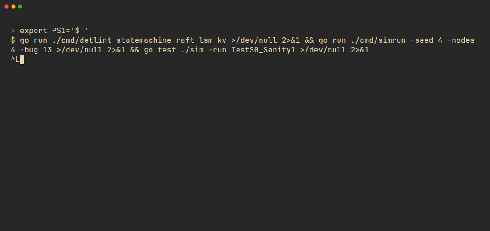

# AetherKV: Simulation-First Replicated Key-Value Store (Raft + LSM + WiscKey)

[](https://github.com/cutaret/AtherKV/actions/workflows/ci.yml)
[](https://go.dev/)
[](#)
[](https://cutaret.github.io/AtherKV/trace_zoo13.html)

**AetherKV** is a linearizable, crash-safe replicated key-value storage engine written in Go with **zero external runtime dependencies**. Every consensus transition, LSM compaction, 512-byte sector tear, and network partition replays deterministically from a single 64-bit seed—achieving **100% rolling SHA-256 trace agreement across 20,000 runs at 8,174 virtual seconds per real second**.

- **Interactive Time-Travel Debugger:** [Explore a live delta-shrunk split-brain trace in your browser (Bug Zoo #13)](https://cutaret.github.io/AtherKV/trace_zoo13.html)
- **Verification Proof:** Uncovered **7 real, unplanted consensus/crash bugs**, caught **17/17 planted Bug Zoo mutations** within 1–4 seeds, and survived **940K+ native Go fuzz executions** across 4 binary parser targets with zero panics or OOMs.
- **Linux NVMe Storage Results (`fsync=ON`):** `FlushedIndex`-gated Raft truncation cuts `fsync` calls by **49.9% (+96.4% throughput, -57.4% p99)**, and WiscKey value separation slashes Write Amplification from **3.67x to 1.00x (5.2x throughput, 2.06x faster than Pebble v1.1.5)** on 2 MiB Llama-3-8B KV-cache blocks.

<p align="center">
  
</p>

<p align="center">
  
</p>

## 30-Second Quickstart

```bash
git clone [https://github.com/cutaret/AtherKV.git](https://github.com/cutaret/AtherKV.git)
cd AtherKV/atherKV

# 1. Run the static AST/type determinism linter across all core state-machine packages
go run ./cmd/detlint statemachine raft lsm kv

# 2. Replay Bug Zoo #13 (4-node split-brain), shrink 20 faults to 3, and export HTML trace
go run ./cmd/simrun -seed 4 -nodes 4 -bug 13 -html docs/trace_zoo13.html

# 3. Run the full verification suite (Stages S0–S4 + all 17 Bug Zoo entries + fuzz seed corpora)
go test -p 1 ./... -count=1

# 4. Launch the interactive 3-node Raft + LSM browser playground on http://localhost:8080
go run ./cmd/aether-server
```

_(From the repository root `AtherKV/`, you can also run `make lint`, `make test`, `make race`, `make fuzz`, `make sim-zoo13`, `make bench`, or `make playground`.)_

---

## Run AetherKV as a Real Database (3-Node Cluster, CLI & Redis RESP2)

Download static binaries for Linux, macOS, and Windows from **[GitHub Releases](https://github.com/cutaret/AtherKV/releases)**, build locally (`make build`), or boot a persistent 3-node Raft + WiscKey cluster in one command:

```bash
# Start 3 persistent nodes (HTTP on 8081-8083, Redis RESP2 on 6379-6381, Option B single-fsync ON)
docker compose up -d --build
```

### Talk to the Cluster with `redis-cli` (Zero-Dependency RESP2)

Requests sent to any follower transparently forward to the active Raft leader:

```bash
redis-cli -p 6379 SET kv/llama3/layer0 "tensor-payload"
redis-cli -p 6380 GET kv/llama3/layer0
redis-cli -p 6379 SCAN 0 MATCH "kv/*" COUNT 10
redis-cli -p 6379 INFO
```

### Talk to the Cluster with `aetherctl` or HTTP

```bash
export AETHERKV_ENDPOINTS="[http://127.0.0.1:8081](http://127.0.0.1:8081),[http://127.0.0.1:8082](http://127.0.0.1:8082),[http://127.0.0.1:8083](http://127.0.0.1:8083)"

# Check Raft leadership, applied index, and fsync counters across all 3 nodes
./bin/aetherctl status

# Linearizable PUT (supports stdin '-' for large WiscKey blobs), GET, CAS, and SCAN
./bin/aetherctl put config/mode "v1"
./bin/aetherctl cas config/mode "v1" "v2"
./bin/aetherctl scan -start config/ -limit 10

# Or use plain curl against any node (followers forward automatically)
curl -X PUT [http://127.0.0.1:8082/v1/kv/hello](http://127.0.0.1:8082/v1/kv/hello) -d "world"
curl [http://127.0.0.1:8083/v1/kv/hello](http://127.0.0.1:8083/v1/kv/hello)

# Test live crash failover on real disk volumes
docker kill aetherkv-n1
./bin/aetherctl status
./bin/aetherctl get config/mode
```

### Single-Node Local Server

```bash
cd atherKV
go run ./cmd/aetherkv -id n1 -data ./aetherkv-data/n1 -http :8080 -resp :6379 -single-fsync
```

## Architecture & Mechanical Determinism Enforcement

Every package above the host-interface seam (`raft`, `lsm`, `kv`, `statemachine`) is a pure state machine with zero direct access to the operating system. All external side effects cross five explicit interfaces defined in `atherKV/sim/interfaces.go` and `atherKV/vfs/vfs.go`:

- **`sim.Clock`:** Monotonic virtual time with configurable per-node static offset and linear drift in parts-per-million (PPM).
- **`sim.Rand`:** Stream-isolated `xoshiro256**` PRNGs seeded via SHA-256 domain separation (`SHA-256(masterSeed, streamName)`).
- **`sim.Scheduler`:** Single-threaded min-heap event queue ordered by `(timeNs, seq)` replacing background goroutines.
- **`sim.Transport`:** Switches seamlessly between the fault-injecting `SimNet` chaos matrix and 4-byte Big-Endian length-prefixed TCP sockets (`transport/tcp`).
- **`vfs.FS` / `vfs.File`:** Abstracts POSIX disk I/O (`OSFS`) and the crashable 512-byte sector-tearing filesystem (`SimFS`).

Determinism is enforced mechanically in CI by **`cmd/detlint`** (`internal/detlint/analyzer.go`), a custom `go/ast` + `go/types` static analyzer that rejects:

- Raw `go func()` goroutine spawns inside core packages.
- Wall-clock reads (`time.Now`, `time.Since`, `time.After`, `time.Sleep`).
- Global PRNG imports (`math/rand`, `math/rand/v2`, `crypto/rand`).
- Non-deterministic `for k, v := range mapVar` iteration (requiring explicit key extraction and `slices.Sort`).

See **[`atherKV/docs/WIRE_FORMAT.md`](atherKV/docs/WIRE_FORMAT.md)** for the complete byte-level specification of the 25-byte Raft WAL frame, 32 KiB fragmented LSM WAL, 40-byte SSTable footer (`0xAE74E255`), 24-byte `VLogPointer`, and TCP framing.

---

## Core Subsystems

- **Deterministic Simulation Kernel (`sim`):** Single-threaded discrete-event loop with stream-isolated PRNGs, rolling SHA-256 trace chain hashing, network nemesis (symmetric/asymmetric partitions, drops, reordering, pauses), and delta-debugging fault schedule shrinking (`ShrinkFaultSchedule`).
- **Sector-Tearing Virtual Filesystem (`vfs`):** Separates `volatileData` (page cache) from `durableData` (synced disk), tracks directory metadata durability (`SyncDir`), and splits unsynced writes across 512-byte sectors during `SimFS.Crash()` to inject dropped, persisted, or mid-sector `0xAA`-torn writes.
- **Zero-I/O Raft Consensus & Segmented WAL (`raft`, `raft/wal`):** Pure `Step`/`Tick` → `Ready` state machine supporting leader election, Figure 8 commit safety, Raft Section 6.4 `ReadIndex` (with current-term no-op barrier), clock-bounded leader leases, `InstallSnapshot`, a 64 MiB segmented CRC32C WAL, and a step-by-step global 6-invariant observer (`raft/observer.go`).
- **Crash-Safe Leveled LSM & WiscKey Value Log (`lsm`):** 32 KiB block-fragmented WAL with group commit, deterministic MVCC skiplist `(UserKey ASC, SeqNum DESC)`, 4 KiB CRC32C SSTables with double-hashing Bloom filters (0.78% FP rate at 10 bits/key), atomic `MANIFEST`/`CURRENT` rotation, snapshot-pinned leveled compaction ($L_0 \rightarrow L_1 \rightarrow L_2$), and WiscKey value separation (`vlog` segments + 24-byte LSM pointers + online segment GC).
- **Linearizability & Range-Scan Checker (`adapters/porcupine`):** Zero-dependency Wing & Gong + Lowe bitmask linearizability checker supporting `PUT`, `GET`, `DELETE`, `CAS`, indeterminate timeouts (`[invokeNs, +Inf)`), full-keyspace multi-key `SCAN` verification, and automatic counterexample shrinking.

---

## Verification Campaigns & Native Fuzzing

| Stage | Campaign                      | Scale                          | Result                 | Speed / Time     |
| :---- | :---------------------------- | :----------------------------- | :--------------------- | :--------------- |
| S0    | Trace Hash Determinism        | 20,000 runs (10K seeds x 2)    | 100% SHA-256 match     | 8,174 virt s/s   |
| S1    | 3/4/5-Node Chaos              | 150 runs                       | 0 invariant violations | 196 virt s/s     |
| S2    | Differential Crash Test       | 5,000 ops + 20 crashes         | 100% oracle match      | 0.18 s total     |
| S2    | SSTable Bloom Filter          | 10,000 negative probes         | 0.78% FP (0% FN)       | < 1 ms           |
| S3    | Full-Stack Raft + LSM         | 30 seeds                       | 0 violations           | 78 ms total      |
| S3    | Real TCP 3-Node Crash         | 3 OS sockets (`127.0.0.1`)     | Linearizable           | 0.52 s total     |
| S4    | Linearizability Oracle        | 1,000 random histories         | 100% match             | Shrunk 7 → 2 ops |
| Fuzz  | Native Go Fuzzing (4 targets) | 940,551 executions (5s/target) | 0 panics / 0 OOMs      | 35.4 s total     |

**Native Go Fuzz Targets:** `FuzzRaftWALRecover` (212K execs), `FuzzLSMWALAndBatchDecode` (189K execs), `FuzzSSTableOpen` (336K execs), and `FuzzPorcupineChecker` (203K execs). All seed corpora run automatically in GitHub Actions CI.

---

## Verified Linux NVMe Benchmarks & Pebble Baseline

All benchmark numbers below were captured via GitHub Actions (`.github/workflows/bench-linux.yml`) across **5 runs per workload** using incompressible high-entropy payloads (modeling FP16 KV-cache tensors) with real POSIX `fsync()` enabled (`vfs.OSFS`). Raw JSON/CSV/hardware artifacts live in [`atherKV/bench/results/`](atherKV/bench/results/).

> **Hardware & OS (`linux_hardware.txt`):** AMD EPYC 9V74 (4 vCPUs, `x86_64`), 15 GiB RAM, Linux `7.0.0-1020-azure`, `ext4` on `MSFT NVMe Accelerator v1.0` (`ROTA=0`), `go1.23.12`.

### 1. AetherKV vs. CockroachDB Pebble v1.1.5 (`fsync=ON`, 5-Run Median)

Pebble lives inside an isolated submodule (`atherKV/bench/pebble_compare/go.mod`) so core AetherKV remains at **0 external dependencies**. Both engines ran sequentially on the same Linux NVMe filesystem with synchronous durability (`OSFS fsync=ON` vs. `pebble.Sync`):

| Workload                         | Engine                             | Med Ops/s | Med MiB/s |    p50 (us) |     p99 (us) |
| :------------------------------- | :--------------------------------- | --------: | --------: | ----------: | -----------: |
| YCSB-A (50% Put / 50% Get, 256B) | AetherKV (`OSFS`, `fsync=ON`)      |     5,594 |       1.4 |       145.8 |        386.2 |
| YCSB-A (50% Put / 50% Get, 256B) | CockroachDB Pebble v1.1.5 (`Sync`) |     9,066 |       2.2 |       147.3 |        403.4 |
| YCSB-B (5% Put / 95% Get, 256B)  | AetherKV (`OSFS`, `fsync=ON`)      |    73,114 |      17.9 |         0.2 |        182.5 |
| YCSB-B (5% Put / 95% Get, 256B)  | CockroachDB Pebble v1.1.5 (`Sync`) |    76,158 |      18.6 |         0.3 |        192.8 |
| 128 KiB Llama-3 1-Token KV Block | AetherKV Inline LSM (`OSFS`)       |       254 |      31.8 |     2,029.0 |     41,468.4 |
| 128 KiB Llama-3 1-Token KV Block | **AetherKV WiscKey VLog (`OSFS`)** | **1,234** | **154.3** |   **497.5** |  **4,812.2** |
| 128 KiB Llama-3 1-Token KV Block | CockroachDB Pebble v1.1.5 (`Sync`) |     1,316 |     164.5 |       372.3 |      2,827.8 |
| 2 MiB Llama-3 16-Token KV Block  | AetherKV Inline LSM (`OSFS`)       |        20 |      40.5 |    22,195.7 |     90,003.6 |
| 2 MiB Llama-3 16-Token KV Block  | **AetherKV WiscKey VLog (`OSFS`)** |   **112** | **224.2** | **8,782.8** | **29,952.9** |
| 2 MiB Llama-3 16-Token KV Block  | CockroachDB Pebble v1.1.5 (`Sync`) |        54 |     108.6 |    16,475.4 |     42,467.6 |

_Notes:_ Pebble v1.1.5 leads on write-heavy 256B YCSB-A (1.6x) due to concurrent WAL batching and background compaction, while AetherKV stays within 4% of Pebble on read-heavy YCSB-B and outperforms Pebble v1.1.5 by **2.06x** on 2 MiB blocks because Pebble v1.1.5 compacts values inline without value-log separation (later Pebble v2 releases introduced separate blob-file value storage).

### 2. Unified 5-Run Llama-3-8B KV-Cache Block Sweep (`OSFS`, Real POSIX `fsync=ON`)

Llama-3-8B KV-cache tensor geometry: $2\ (\text{K,V}) \times 32\ \text{layers} \times 8\ \text{KV heads} \times 128\ \text{dim} \times 2\ \text{B (FP16)} = 128\ \text{KiB/token}$, or **2 MiB** per 16-token PagedAttention block.

| Block Size                    | Inline WA | WiscKey WA | Inline MiB/s | WiscKey MiB/s | Inline p99 (us) | WiscKey p99 (us) |  Speedup |
| :---------------------------- | --------: | ---------: | -----------: | ------------: | --------------: | ---------------: | -------: |
| 1 KiB (Below 4 KiB Threshold) |     2.91x |      2.91x |          1.8 |           1.6 |         9,299.7 |          4,787.4 |     0.9x |
| 16 KiB Chunk                  |     4.65x |  **1.02x** |          7.1 |      **25.9** |        53,137.3 |      **1,122.0** | **3.6x** |
| 128 KiB (1-Token Block)       |     4.50x |  **1.00x** |         38.8 |     **157.5** |        18,302.4 |      **1,748.8** | **4.1x** |
| 512 KiB (4-Token Block)       |     4.00x |  **1.00x** |         46.6 |     **233.9** |        49,172.4 |      **6,341.4** | **5.0x** |
| 2 MiB (16-Token Block)        |     3.67x |  **1.00x** |         49.1 |     **256.0** |       112,999.4 |      **9,970.0** | **5.2x** |

### 3. Durability Coupling & Core YCSB/Cluster Suite (`OSFS` vs. `SimFS`)

| Workload                                          | `OSFS` Med Ops/s (`fsync=ON`) |      `OSFS` p99 (us) | `SimFS` Med Ops/s (CPU/Arch) | Write Amp |           Fsyncs |
| :------------------------------------------------ | ----------------------------: | -------------------: | ---------------------------: | --------: | ---------------: |
| YCSB-A (50% Put / 50% Get)                        |                         2,453 |              2,552.1 |                      162,587 |     3.47x |                - |
| YCSB-B (5% Put / 95% Get)                         |                        17,291 |                238.3 |                      358,497 |     3.45x |                - |
| YCSB-E (5% Put / 95% Scan)                        |                         8,869 |                284.8 |                       33,899 |     3.49x |                - |
| 3-Node Cluster (50% Write / 50% `ReadIndex`)      |                           239 |             67,338.4 |                       15,020 |     1.00x |                - |
| **Option A (Dual Fsync: Raft WAL + LSM WAL)**     |                           662 |             21,390.8 |                       80,720 |     1.00x |              401 |
| **Option B (Single Fsync: `FlushedIndex` Fence)** |            **1,300 (+96.4%)** | **9,118.2 (-57.4%)** |         **119,046 (+47.5%)** | **1.00x** | **201 (-49.9%)** |

---

## Standalone Developer Tools (`aether_check` & `detlint`)

Two tools inside AetherKV work standalone on external Go repositories and distributed-system test histories:

### 1. Drop-In Linearizability & Multi-Key `SCAN` Checker (`cmd/aether_check`)

Feed any JSON-Lines client history containing `PUT`, `GET`, `DELETE`, `CAS`, or multi-key `SCAN` operations (with optional indeterminate timeouts where `return_ns: 0`) to verify linearizability and automatically shrink failing histories down to minimal conflicting operations:

```json
{"id":1,"client_id":1,"kind":"PUT","key":"k1","input_val":"v1","invoke_ns":10,"return_ns":20}
{"id":2,"client_id":2,"kind":"GET","key":"k1","output_val":"v1","invoke_ns":25,"return_ns":30}
{"id":3,"client_id":2,"kind":"SCAN","key":"k1","end_key":"k9","scan_out":"k1=v1","invoke_ns":35,"return_ns":40}
```

```bash
cd atherKV
go run ./cmd/aether_check -in path/to/history.jsonl
```

### 2. Static Determinism Linter (`cmd/detlint`)

Run `detlint` against any Go package paths in your own deterministic-simulation codebase to catch forbidden goroutines, `time.*` reads, global RNG imports, or unordered `range map` loops before they enter CI:

```bash
cd atherKV
go run ./cmd/detlint path/to/pkg1 path/to/pkg2
```

---

## The 17-Entry Reproducible Bug Zoo

Every entry below toggles a real consensus, storage, or durability bug via `raft.BugConfig`, `lsm.LSMBugConfig`, or `kv.KVBugConfig` to verify detector sensitivity within 1–4 seeds (full postmortems in [`atherKV/docs/bug-zoo/CATALOG.md`](atherKV/docs/bug-zoo/CATALOG.md)):

| Bug ID | Subsystem    | Planted Bug                  | Detector              | Seed / Shrink    |
| :----- | :----------- | :--------------------------- | :-------------------- | :--------------- |
| #1     | Raft Core    | Fig. 8 earlier-term commit   | `StateMachineSafety`  | Seed 1           |
| #2     | Raft + VFS   | Vote reply before persist    | `TermMonotonicity`    | Seed 1           |
| #3     | Raft + WAL   | Ack Append before `fsync`    | `CommittedDurability` | Seed 1           |
| #4     | Raft Core    | Stale Append log truncate    | `CommittedDurability` | Seed 4           |
| #5     | KV + Raft    | Blind leader read            | `Porcupine`           | Seed 5 (2 ops)   |
| #6     | KV + Clock   | Lease read under clock skew  | `Porcupine`           | Seed 606 (2 ops) |
| #7     | KV Session   | No client session dedup      | `Porcupine`           | Seed 707 (2 ops) |
| #8     | LSM WAL      | Accept torn WAL tail         | `CrashSyncOracle`     | Seed 8           |
| #9     | LSM + VFS    | Missing `MANIFEST` `SyncDir` | `SimFSCrashOracle`    | Seed 9           |
| #10    | LSM Compact  | Early tombstone drop         | `ModelBasedOracle`    | Seed 10          |
| #11    | Raft + LSM   | Truncate past `FlushedIndex` | `CrashRecoveryOracle` | Seed 1111        |
| #12    | KV Snapshot  | Snapshot omits dedup table   | `Porcupine`           | Seed 1212 (1 op) |
| #13    | Raft Core    | Even-cluster quorum bug      | `CommittedDurability` | Seed 4 (20 → 3)  |
| #14    | KV + LSM     | Split data & `appliedIndex`  | `CrashEnumeration`    | Seed 1           |
| #15    | WiscKey VLog | Pointer synced before VLog   | `CrashSyncOracle`     | Seed 1           |
| #16    | WiscKey VLog | VLog GC drops live value     | `ModelBasedOracle`    | Seed 16          |
| #17    | WiscKey VLog | Accept torn VLog tail        | `CrashSyncOracle`     | Seed 17          |

## Seven Real, Unplanted Bugs Caught by the Simulator

1. **Raft Section 6.4 `ReadIndex` Uncommitted Prefix Bug (Seed 10):** A newly elected leader with uncommitted earlier-term entries served `ReadIndex` at `commitIdx = 0` before committing a current-term no-op entry (caught by Porcupine).
2. **Unverified `commitIdx` Advance on `MsgHeartbeat` (Seed 12):** `handleHeartbeat` advanced a follower's `commitIdx` without `(prevLogIndex, prevLogTerm)` verification, letting a deposed Term 1 leader commit an overwritten entry (caught by `StateMachineSafety`).
3. **Torn WAL Header Unbounded Allocation OOM:** A 512B sector torn with `0xAA` bytes caused `SegmentedWAL` to pass `length = 0xAAAAAAAA` (2.86 GB) to `make([]byte, length)` before bounds validation.
4. **Zombie LSM WAL Replay After Unsynced Truncation (Step 500 Crash):** Resetting `active.wal` after `Flush()` without syncing let pre-flush WAL sectors (`seq = 499`) survive crash and shadow newer $L_0$ SSTable state (`seq = 500`).
5. **`SimFS` Sub-Sector Tear Bleed:** Sector-granular crash tearing initially overwrote full 512B boundaries rather than clamping to the unsynced write sub-range, corrupting previously synced records sharing the same sector.
6. **`SegmentedWAL.TruncateSuffix` Resurrection Bug:** Suffix truncation cleared the in-memory index map without truncating the underlying `SimFS` segment file, resurrecting overwritten entries on reboot.
7. **`SimFS.WriteAt` Quadratic Slice Reallocation:** Exact-sized slice allocations on every 32 KiB append triggered 4.2 GB of allocations across 512 appends on 2 MiB blocks until replaced with geometric capacity doubling.

---

## Repository Layout

```text
AtherKV/
├── .github/workflows/
│   ├── ci.yml                               # detlint + race detector + S0-S4 & 17-Bug Zoo CI
│   ├── bench-linux.yml                      # Linux NVMe OSFS/SimFS & Pebble v1.1.5 benchmarks
│   └── record-demo.yml                      # Automated VHS terminal demo recorder
├── docs/trace_zoo13.html                    # GitHub Pages live interactive Bug Zoo #13 trace
├── Dockerfile                               # ~12 MB static container for aether-server playground
├── Makefile                                 # One-command lint, test, race, fuzz, sim, and bench
└── atherKV/
    ├── go.mod                               # Module [github.com/cutaret/aetherkv](https://github.com/cutaret/aetherkv) (0 external deps)
    ├── cmd/
    │   ├── detlint/main.go                  # Static AST/type determinism linter CLI
    │   ├── aether_check/main.go             # Standalone JSONL linearizability & SCAN checker CLI
    │   ├── simrun/main.go                   # Deterministic seed replay, shrinker & HTML trace CLI
    │   ├── benchrun/main.go                 # 5-run OSFS/SimFS benchmark runner (JSON/CSV/MD)
    │   └── aether-server/main.go            # Interactive 3-tab Raft+LSM+BugZoo web playground
    ├── internal/detlint/analyzer.go         # AST + go/types determinism rules
    ├── sim/                                 # Min-heap kernel, StreamRand, NodeClock, SimNet, HTML viewer
    ├── vfs/                                 # POSIX OSFS + 512B sector-tearing SimFS
    ├── statemachine/                        # StateMachine interface + MemStore reference oracle
    ├── raft/                                # Pure zero-I/O Raft, 6-invariant observer & segmented WAL
    ├── lsm/                                 # 32K WAL, skiplist, Bloom, SSTable, MANIFEST, WiscKey VLog
    ├── kv/service.go                        # Replicated KV service, ReadIndex, leases & Option A/B
    ├── transport/tcp/tcp.go                 # 4B Big-Endian length-prefixed TCP transport
    ├── adapters/porcupine/                  # Wing & Gong + Lowe bitmask & multi-key SCAN checker
    ├── zoo/                                 # Multi-node simulation harness & 17-entry Bug Zoo suite
    ├── bench/
    │   ├── pebble_compare/                  # Isolated Pebble v1.1.5 baseline submodule
    │   └── results/                         # Raw Linux NVMe JSON, CSV, MD & hardware artifacts
    └── docs/
        ├── WIRE_FORMAT.md                   # Exact byte layouts for Raft WAL, LSM, SSTable & VLog
        ├── METRICS.md                       # Complete empirical telemetry & verification ledger
        ├── bug-zoo/CATALOG.md               # Detailed postmortems for all 17 Bug Zoo entries
        ├── adr/                             # Architecture Decision Records (ADR 001 – ADR 007)
        └── assets/                          # architecture.svg, demo.tape, demo.gif
```

## Scope Boundaries & Honest Engineering Limits

- **Explicit Non-Goals:** AetherKV intentionally omits multi-Raft range sharding, distributed cross-shard transactions (2PC/Percolator), SQL parsing, TLS/RBAC authentication, and block compression.
- **Simulation vs. Physical Hardware:** `SimFS` models 512-byte sector tearing and unsynced directory-entry rollback based on POSIX/NVMe persistence contracts, while Linux `OSFS` and real TCP tests exercise OS syscalls and sockets; neither replaces physical power-cut testing on raw NVMe controller firmware.
